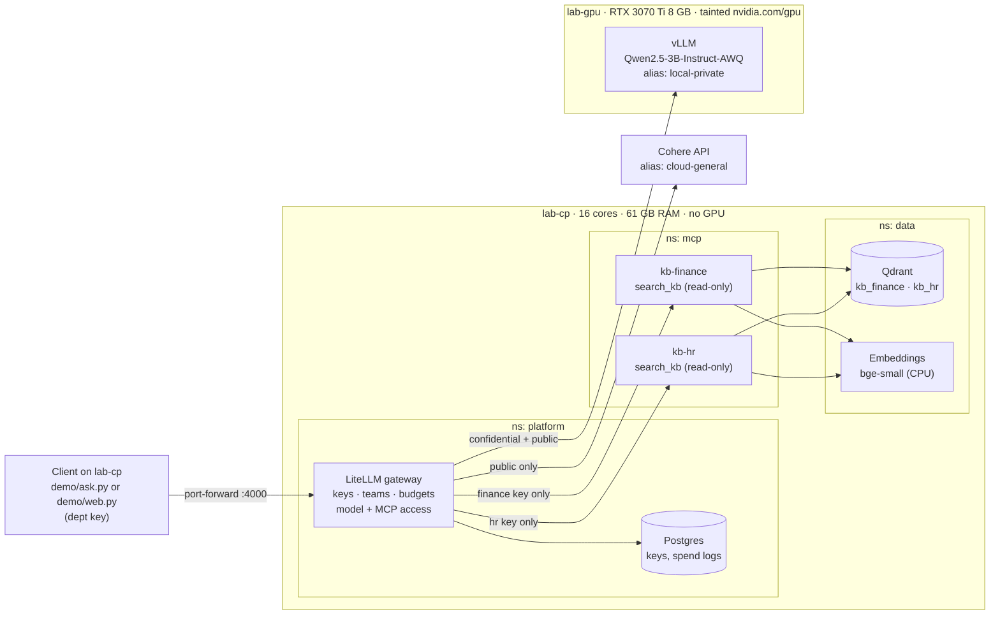

# Architecture

Two physical machines on a home LAN, both running Ubuntu Server 26.04.1 LTS, form one K3s cluster.

## Request path

1. The demo client opens LiteLLM's `/mcp` endpoint and calls `/v1/chat/completions`, both with the
   department's virtual key.
2. LiteLLM checks the key: which model aliases it may use, which MCP servers it may see, and its
   remaining budget.
3. The model asks for `search_kb`. The client calls the tool through LiteLLM, which forwards the call
   to that department's MCP server with that server's own bearer token.
4. The MCP server embeds the query, searches **its own** collection (fixed by its `DEPT` setting),
   writes an audit line, and returns passages with `source_id`s.
5. The model answers and cites the `source_id`s.

## Controls by layer

| Layer | Control |
|---|---|
| Gateway | Per-team model allow-list (classification rule), MCP server allow-list, budgets, spend logs |
| Network | Default-deny ingress per namespace; only LiteLLM reaches vLLM and MCP; only MCP reaches Qdrant |
| MCP server | One tool, no write path, bounded input, department fixed at start-up, bearer token, audit log |
| Scheduling | GPU node tainted; only vLLM and the NVIDIA device plugin tolerate it, and only vLLM requests `nvidia.com/gpu` |
| Secrets | Local files outside git, then Kubernetes secrets; nothing in images or config |

See `ADR-001-ai-workload-placement.md` for why each workload runs where it does, and `SECURITY.md`
for the threat model.
